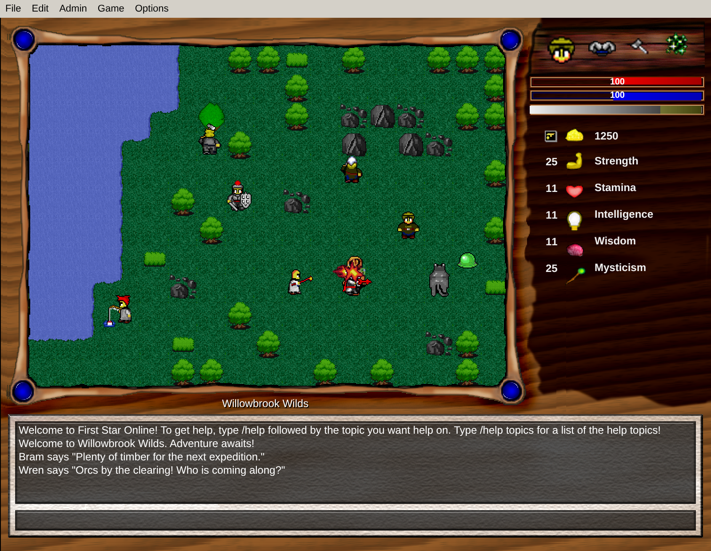
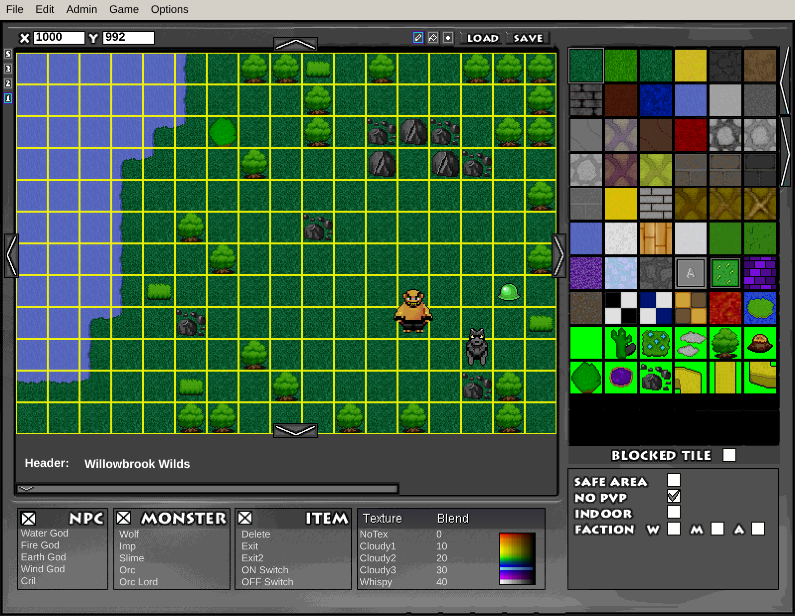

# Second Star Online

**A classic online world. A new life in your browser.**

Second Star Online brings First Star Online 1.6 to the web: a multiplayer RPG where you can hunt monsters, master spells, craft your next weapon, and build a home alongside friends. Rediscover the original art, sounds, and familiar interface, with a modern server that keeps the world in sync.

Open source and ready to host, Second Star Online gives you the tools to create a community and make the world your own.



*Willowbrook Wilds, the starter landscape, shown with a staged party fishing, gathering, and fighting monsters.*

## Find your adventure

- **Explore and grow.** Venture across maps, face monsters, learn skills and spells, and gather resources for your next expedition.
- **Make your mark.** Craft equipment, build houses, trade with other players, and set up shop.
- **Find your people.** Join guilds and factions, exchange messages, or take a break with casino games and checkers.
- **Build your world.** Shape maps and NPCs with in-game editors, tune server settings, and create a place for your community to call home.

The remake preserves the original's distinctive gameplay quirks while moving authority to the server to close harmful exploits. Read about the [kept quirks](docs/bug-ledger.md) and [deliberate differences](docs/divergences.md).

## Start your own server

The quickest way to get a world running is with the [public Docker image](https://github.com/jberlyn/second-star-online/pkgs/container/second-star-online). You only need Docker; the image includes the server, browser client, and game assets.

```sh
docker run -d --name second-star-online \
  --pull always \
  --restart unless-stopped \
  --stop-timeout 30 \
  -p 127.0.0.1:3000:3000 \
  -v sso-data:/data \
  ghcr.io/jberlyn/second-star-online:latest
```

Open [http://localhost:3000](http://localhost:3000) on the Docker host and create your account. Your world is saved in the `sso-data` Docker volume across container replacements. Published images target **Linux AMD64**. Prefer a host directory? The server guide includes a [bind mount alternative](docs/running-a-server.md#bind-mounts-alternative-to-named-volumes).

Each new server begins in Willowbrook Wilds, a forest-and-lake seed world that you can expand with the in-game editors. Ready to invite players? Follow the [server guide](docs/running-a-server.md) for Docker Compose, public hosting with HTTPS, administrator access, updates, and backups. No repository checkout or local build is needed to host the standard game.

## Make it your own



*The same forest in the built-in World Editor. Shape the map, place monsters and items, and save your changes in-game.*

Use the in-game World Editor, NPC Editor, and server settings to shape your server. For deeper changes, the [modding guide](docs/modding.md) explains how to customize game data, add art and sound, and build your own image.

Want to work on the game itself? Clone this repository, install [Bun](https://bun.sh/), and run:

```sh
bun install --frozen-lockfile
bun run dev
```

See the [contributor command guide](docs/scripts.md) for build and verification commands, and the [architecture](docs/architecture.md) for a tour of the codebase.

## Explore further

- [Documentation](docs/README.md) — hosting, modding, gameplay systems, and performance.
- [Game system guides](docs/guides/README.md) — how the world and its mechanics work.
- [Report an issue](https://github.com/jberlyn/second-star-online/issues) — share a bug or suggest an improvement.
- [LICENSE](LICENSE) and [NOTICE](NOTICE) — the SSO code license and attribution for original art, sounds, and other material.
